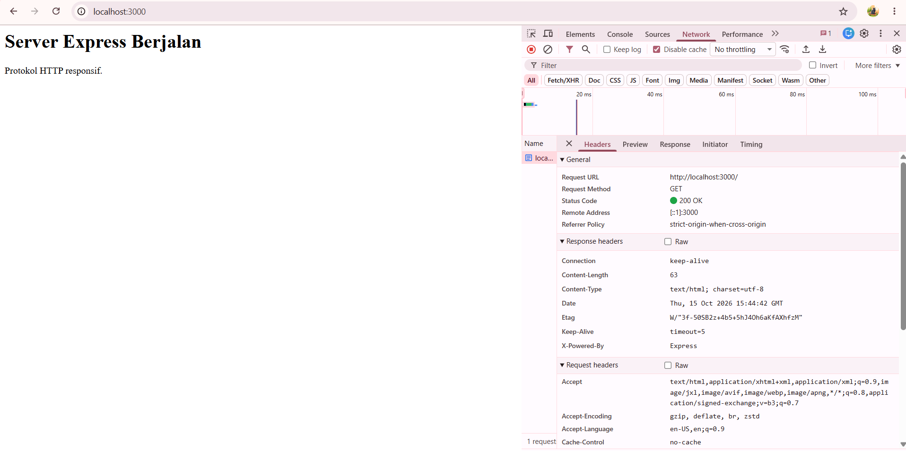
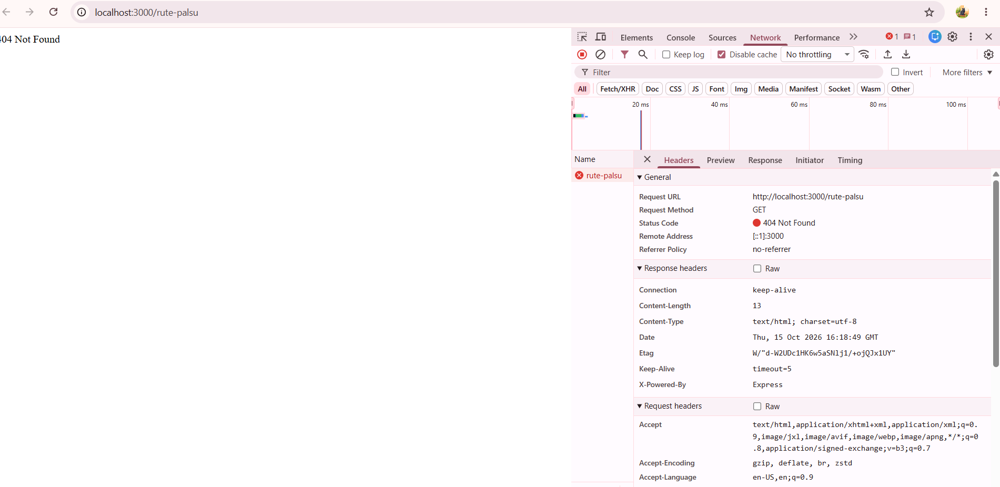
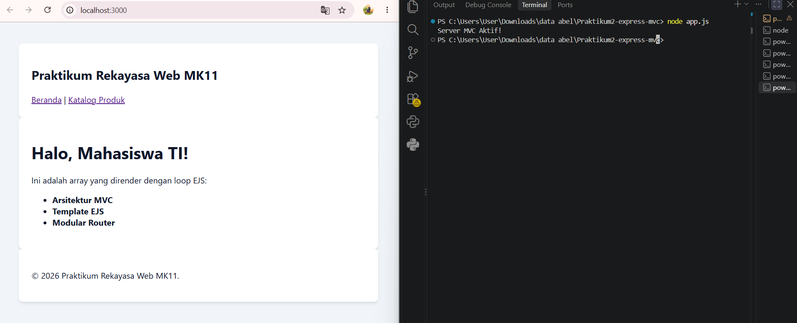
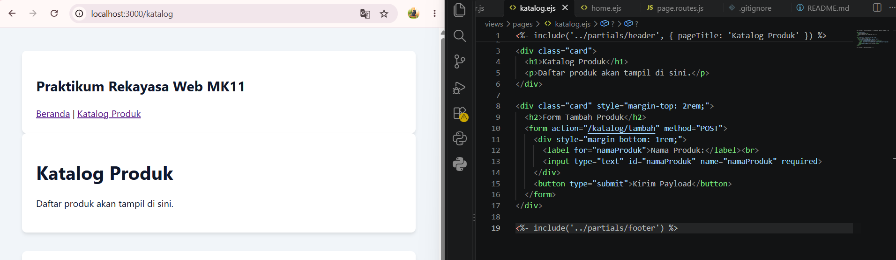
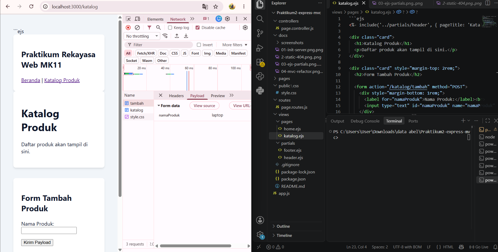
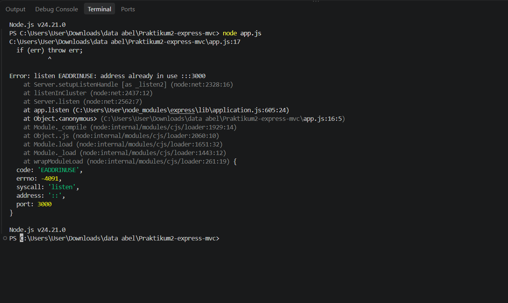
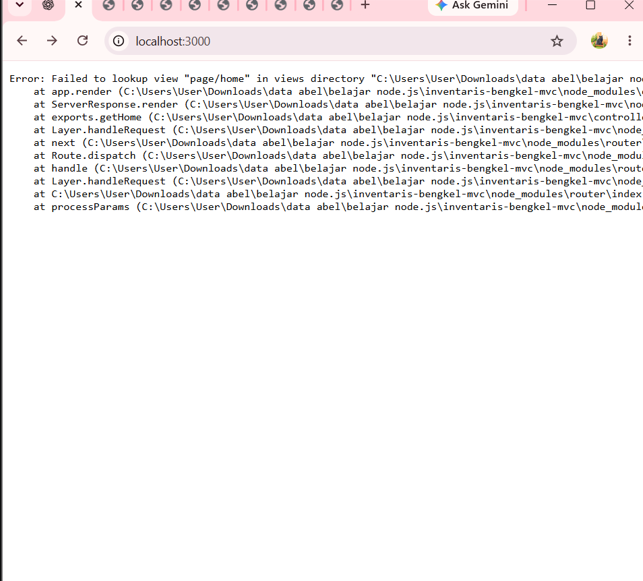
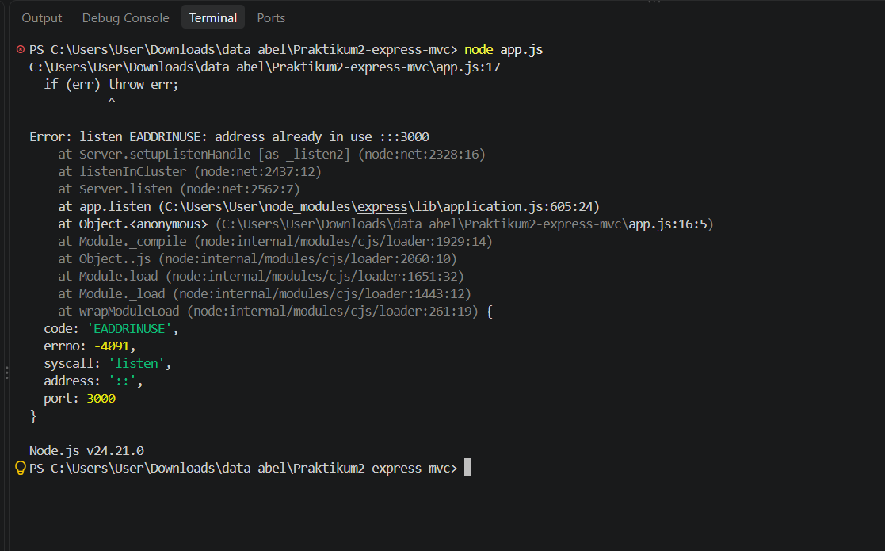

# Praktikum 2 — Express MVC

## Deskripsi
Proyek ini dibuat untuk praktikum pemrograman web menggunakan Node.js, Express.js, dan EJS dengan pola arsitektur Model-View-Controller (MVC).

## Teknologi
- Node.js
- Express.js
- EJS
- HTML dan CSS

## Struktur Folder
- `app.js` — file utama aplikasi
- `routes/` — pengaturan routing
- `controllers/` — logika pengolahan request
- `views/` — tampilan EJS
- `public/` — file CSS dan aset statis
- `docs/` — dokumentasi screenshot hasil praktikum

## Cara Menjalankan
1. Buka terminal di folder proyek.
2. Pastikan Node.js dan dependensi proyek sudah terpasang.
3. Jalankan aplikasi dengan `node app.js`.
4. Buka `http://localhost:3000` di browser.

## Dokumentasi Hasil Praktikum

### 1. Inisialisasi Server

### 2. Static dan 404

### 3. EJS Partials

### 4. Refactor MVC

### 5. POST Payload

### 6. Error Undefined

### 7. Error Lookup

### 8. Error Port

## Identitas
- Nama: Adelia Putri
- NIM: 42530038
- Kelas: Pagi
